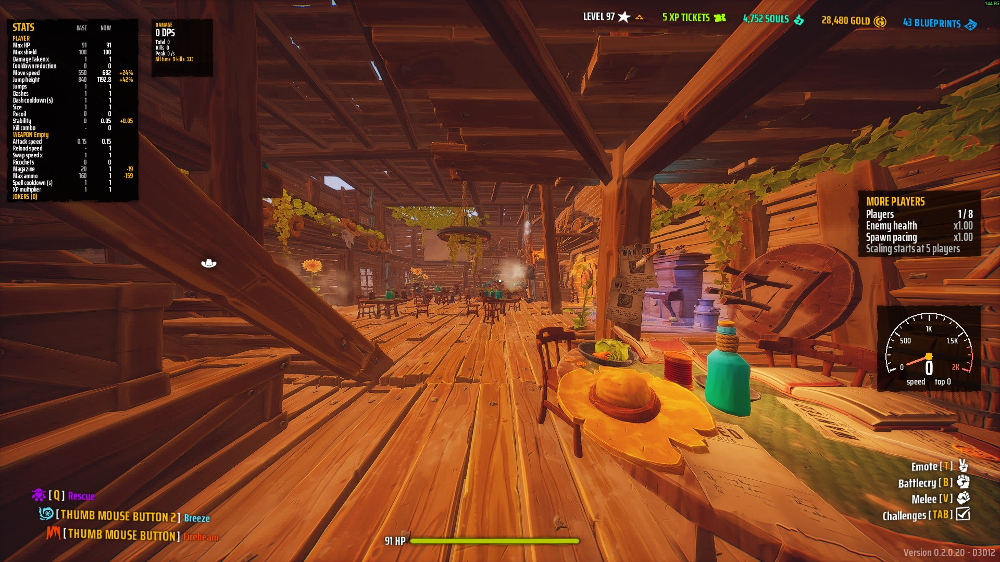
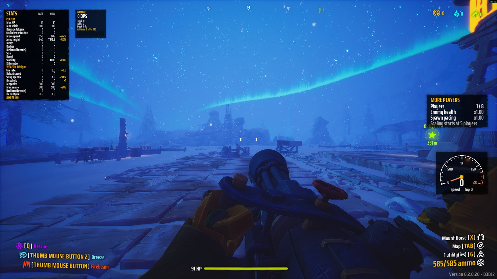

# Sveney Super Friends Together Time 5000

Far Far West mods built in-house, plus one installer bundle so every player runs identical files.
The pack was called FFWModpack up to 1.5.0; the installer upgrades that install in place.

## What it does

- **More players**: up to 8 in a lobby instead of 4. Enemies keep getting tougher past 4 players, the objectives that break with 5 or more players work, and players 5 to 8 get their own name colours.
- **Damage meter**: live damage per second, total damage, kills and a graph on the left of the screen. F7 shows or hides it, F8 resets it.
- **Stats panel**: your stats, your weapon's stats and what each Joker adds. F6 shows or hides it.
- **Speedometer**: how fast you are moving, and your top speed.
- **Auto dash**: hold the dash button and you dash again every time you land.
- **Muzzle flash off**: your own gun's flash no longer blocks your aim.
- **Kill streaks**: call-outs at 10, 25, 50, 100 and 200 kills in a row.
- **Clear zone at the crosshair**: objective markers, pings, icons and name tags fade inside an adjustable circle around the crosshair, so they stop covering what you aim at.
- **Teammate hit warning**: a teammate your shot lands on flashes in a colour you pick, your hit marker turns that colour and an error buzz plays.
- **Minigun spin sound**: a volume slider and a mute box for the barrel whine of every minigun you hear.
- **F9 edit mode**: move and resize the panels, switch any of the extras on or off.
- **One installer**: everyone gets exactly the same files. Verify.bat shows a fingerprint that must match the host's. Update.bat gets the newest pack.

Both shots are from a one-player test, so the numbers sit at zero and x1.00; they fill in with a team.

## Download and install

Newest pack: https://github.com/xuuxij/Sveney-Super-Friends-Together-Time-5000/releases/latest (the `SveneySuperFriendsTogetherTime5000-v*.zip` file under Assets).

1. Close Far Far West.
2. Extract the zip anywhere (Desktop is fine).
3. Double-click `Install.bat`. It finds the game through Steam. If Windows shows "Windows protected your PC", click More info, then Run anyway.
4. Double-click `Verify.bat`. It must say OK and show the same fingerprint as everyone else in the lobby.

Later: `Update.bat` checks this page for a newer pack and installs it. `Uninstall.bat` removes the pack and puts back whatever the install moved aside.
The host ticks "Allow mods" when creating the room. Made for Far Far West 0.2.0.20 - CL 915; after a game update, wait for a new pack.

## What is in the repo

- `src/Mods/DamageMeter` – DPS / total / peak / 30 s graph (F7 toggle, F8 reset)
- `src/Mods/StatsPanel` – base vs current stats, weapon stats, active Jokers (F6, Ctrl+F6 dumps raw values to UE4SS.log)
- `src/Mods/Extras` – More Players panel (reads the MorePlayers mod's shared variables), speedometer, auto dash, muzzle flash switch, kill-streak call-outs, clear zone at the crosshair, teammate-hit warning (glow, hit marker colour, sound), minigun spin sound volume, and the OPTIONS list in F9 edit mode (Ctrl+F5 dumps every part's state to UE4SS.log); one file per part
- `src/Mods/MorePlayers` – lobbies of up to 8: lobby cap on the host, player-count scaling continued past 4 (one hook on `F_GetCurveByNumberOfPlayers`), gold magnet table fix, name colours for players 5..8, status for the panel; `settings.txt` next to Scripts
- `tools/morepak/` – builds `ZZZ_SveneySuperFriendsTogetherTime5000_P` (13 vanilla Blueprints with 16 byte patches: player-count Selects fall back to the 4-player value, 8 lobby rows) from the installed game with retoc; `patches.json` is the spec, `kismet.py` the bytecode disassembler used to derive and re-derive it
- `src/Mods/shared/FFWUi` – shared UMG-in-code helpers (panels, tick boxes, a draggable slider, saved layout and settings); `asset()` must not be called from inside a `RegisterHook` callback, loading there freezes the game
- `config/` – pack definition (name, title, version, game build lock, UE4SS asset + hash, pak name, update repository), UE4SS settings, AOB signatures
- `installer/` – Install/Verify/Update/Uninstall scripts shipped inside the zip
- `tools/Build-Pack.ps1` – builds `dist/SveneySuperFriendsTogetherTime5000-v<version>.zip`
- `tools/list_utoc.py` – lists asset paths from the game's IoStore index
- `dev/FFWProbe` – discovery mod, never shipped

`vendor/` is not tracked: `vendor/ue4ss/<asset from config/pack.json>` (official UE4SS-RE release,
hash-checked by the build) and `vendor/retoc/<retocAsset from config/pack.json>` (trumank/retoc release zip, hash-checked).
The pak is built from the game's own files on every pack build; nothing third-party ships in the pack any more.

After a game patch: check the exe hash in `config/pack.json`, re-test the signatures and hooks, re-derive
`tools/morepak/patches.json` (the build stops on any vanilla hash or byte mismatch; `kismet.py <json> <uexp> --at 0x..`
shows the bytecode around an offset), bump the version, rebuild.
